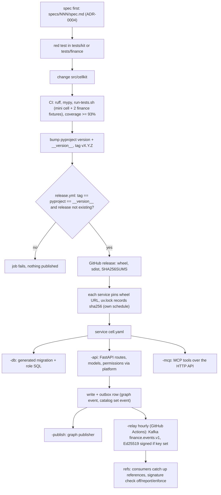
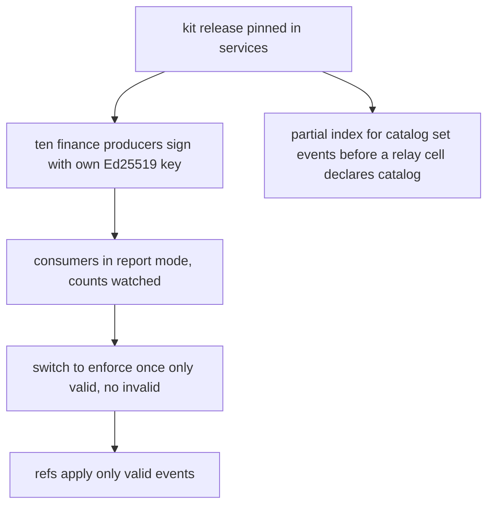

# 01 — Business process (As-Is / To-Be)

platform-cellkit คือ library (ไม่ใช่ service) ที่ทุก cell ของ Solo Empire ใช้สร้างตัวเองจาก `cell.yaml`: migration และ role SQL, FastAPI routes, permissions, graph events, outbox relay, cross-cell references และ MCP server แต่ละ service อยู่ repo ของตัวเองและ pin wheel ที่ release จาก repo นี้

Last reviewed: 2026-11-28 · commit `e1ab7c1`

## As-Is (จากโค้ดวันนี้)

Sources: `README.md`, `src/cellkit/server.py`, `src/cellkit/app.py`, `src/cellkit/sqlgen.py`, `src/cellkit/publisher.py`, `src/cellkit/relay.py`, `src/cellkit/refs.py`, `src/cellkit/signing.py`, `src/cellkit/mcp.py`, `.github/workflows/ci.yml`, `.github/workflows/release.yml`, `.claude/verify.md`, `CHANGELOG.md`

ข้อเท็จจริงจากโค้ดและเอกสาร:

- release ล่าสุดใน `CHANGELOG.md` คือ 1.1.13 (2026-11-26); ตัวอย่าง pin ใน `README.md` ยังเป็น v1.1.6
- การตั้ง `<CELL>_EVENT_SIGNATURES` ของแต่ละ finance service อยู่ใน Railway / GitHub Actions ของ service นั้น ไม่ได้อยู่ใน repo นี้ [ต้องยืนยัน] ว่าทั้งสิบ service อยู่ที่ `enforce`
- ยังไม่มี cell ใดที่รัน relay และประกาศ `catalog` พร้อมกัน (`CHANGELOG.md` 1.1.10)

## To-Be (`specs/002-signed-events/spec.md` §Rollout, `CHANGELOG.md` 1.1.10)

Sources: `specs/002-signed-events/spec.md`, `specs/001-platform-cellkit-package/spec.md`, `CHANGELOG.md`

## Gap

| ID | As-Is → To-Be | Status | Owner | Evidence |
|---|---|---|---|---|
| G1 | producer field ใน `finance.events.v1` ปลอมได้ → envelope ลงนาม Ed25519 และ consumer ตรวจลายเซ็น (โค้ดใน kit) | done | claude | `CHANGELOG.md` 1.1.0, 1.1.1; `src/cellkit/signing.py`; `specs/002-signed-events/spec.md` AC-01..AC-06 |
| G2 | rollout ขั้น 2–4 (key ใน Infisical, report แล้ว enforce) อยู่นอก repo นี้ → ทั้งสิบ finance service อยู่ที่ `enforce` | doing | owner | `specs/002-signed-events/spec.md` §Rollout; สถานะใน service [ต้องยืนยัน] |
| G3 | cell ที่รัน relay และประกาศ `catalog` จะ scan set events ซ้ำทุก batch → เพิ่ม partial index ก่อนเปิดใช้ | todo | claude | `CHANGELOG.md` 1.1.10 ("it needs a partial index for those rows") |
| G4 | 25 service เคยมี `src/cellkit` ของตัวเอง → package เดียวที่ pin ด้วย wheel | done | claude | `specs/001-platform-cellkit-package/spec.md` (implemented v1.0.0) |

## Open questions

- อัปเดตตัวอย่าง pin ใน `README.md` (v1.1.6) ให้เป็น release ล่าสุดหรือไม่
- AC-04 ของ SPEC-001 (แต่ละ service คง SQL เดิมหลังสลับเป็น wheel) ตรวจที่แต่ละ service ไม่มีหลักฐานรวมใน repo นี้ [ต้องยืนยัน]
